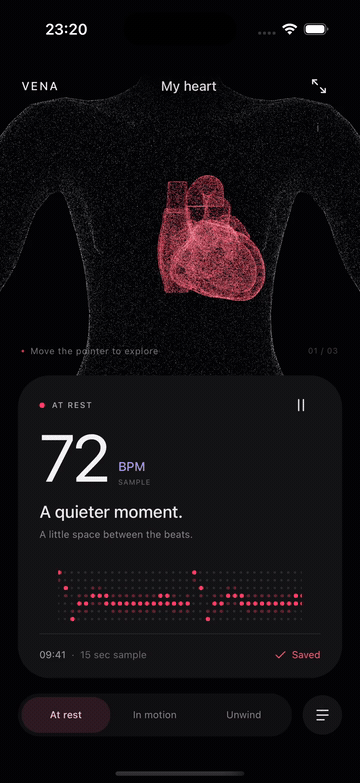

<p align="center">
  
</p>

<h1 align="center">Vena</h1>

<p align="center">An interactive heart made from 200,000 points of light.</p>

<p align="center">
  <a href="https://nativescript-vue.org/">NativeScript-Vue 3</a> ·
  <a href="https://jolt.rafaelaugusto.dev/">Jolt RC.11</a> ·
  SceneKit · iOS
</p>

<p align="center">
  
</p>

<p align="center"><sub>Recorded in the iPhone simulator. <a href="resources/preview.png">Still preview</a></sub></p>

Move the mouse across the body and the particles part around it. The heart stays whole. Every beat sends a red wave out through the chest, fading to white as it travels. Click the heart for an extra pulse, or expand it to get a closer look.

Vena is a small iOS motion experiment. Everything runs locally, including saved rhythms. The readings are sample data: the app does not measure heart rate or connect to HealthKit.

## Run locally

You need macOS, Node 22, the NativeScript CLI, Xcode with an iOS simulator, and CocoaPods. The project was built with NativeScript CLI 9.1.

```sh
git clone https://github.com/rafaelaugustos/vena-ns.git
cd vena-ns
nvm use
npm ci
npm run ios
```

To choose a simulator:

```sh
xcrun simctl list devices available
npm run ios -- --device <simulator-udid>
```

The native runner handles Homebrew CocoaPods' Ruby paths inside its own process. Both Jolt packages are pinned to `0.1.0-rc.11`.

### Mouse hover in the iPhone simulator

An iPhone simulator normally treats mouse input as touch. To preview hover, leave the app open and run this in another terminal:

```sh
npm run pointer -- <simulator-udid>
```

Select the Vena window in Device Hub or Simulator, then move the mouse over the body. Allow macOS Accessibility access for the terminal if prompted. Stop the helper with Ctrl-C, and restart it after reinstalling the app.

The helper maps the Mac cursor to the scene through a file in the simulator app's cache. It is restricted to development simulator builds. Native hover uses `UIHoverGestureRecognizer` on devices that support a pointer; the current preview was checked on the iPhone simulator with this helper.

## Interaction

| Action | Response |
| --- | --- |
| Move the pointer | The torso parts around it and the scene turns slightly. |
| Click the heart | An extra beat sends a wave from the heart without resetting the rhythm. |
| Click the torso | A wave spreads from the point you clicked. |
| Pause | The automatic pulse stops. Hover and clicks still work. |
| Expand | The heart fills the scene, with a control to bring the body back. |
| Save | The selected rhythm stays in the local library. |

The three samples run at **72**, **108**, and **58 BPM**. Tap **VENA** to replay the opening.

## How it's built

SceneKit draws the anatomy: 160,000 points for the torso and 40,000 for the heart, with an extra heart pass for the glow. The point clouds are sampled from meshes ahead of time and bundled as binary assets.

Jolt drives the scene through typed shader uniforms. A repeating `motionValue` sets the heartbeat phase; the shader uses that phase for the heart's movement and the red-to-white wave. Clicks have their own pulse animation, so they can overlap the automatic beat. Springs handle focus, rotation and pointer response.

The interface uses Jolt timelines for the opening and reveals, `press` for button feedback, and `shape` for the icons and LED signal. Motion scopes own playback. The scene stops rendering in the background, and Reduce Motion disables continuous movement.

There is no JavaScript loop updating each particle. The anatomy, hit testing and shader math belong to the app; Jolt controls the animation parameters.

```text
src/
  components/    Cards, controls, opening overlay and library
  composables/   Selected rhythm and local persistence
  domain/        Sample sessions and signal data
  motion/        Opening and interface timelines
  scene/         Native rendering, shaders, pointer input and icons
  assets/        Bundled anatomy point clouds
scripts/         Native runner, simulator pointer helper and asset exporters
resources/       Preview, icon source and anatomy attribution
tests/           Data validation and heart hit testing
```

The current scene targets iOS. Android scaffolding is included, but it does not implement the same particle scene. There is no Web app in this repository.

## Checks

```sh
npm run typecheck
npm test
npm run build:ios
```

The tests validate saved data, the signal function, bundled point clouds, and heart hit testing during focus, rotation and pulse. Visual changes also need a simulator check; these tests do not measure rendering performance.

## Credits

- **Heart:** BodyParts3D, © The Database Center for Life Science, [CC BY 4.0](https://creativecommons.org/licenses/by/4.0/), adapted from OrganUI's prepared model. [Attribution and modifications](resources/anatomy/HEART-ATTRIBUTION.md).
- **Torso:** MakeHuman `hm08`, CC0. [Sources and export instructions](resources/anatomy/README.md).
- **App icon:** generated artwork. The [source image](resources/vena-icon.png) and [generation prompt](resources/icon-prompt.txt) are included. `npm run icons` rebuilds the app icons and launch artwork with ImageMagick.

Keep the anatomy attribution with redistributed models and images of them.
