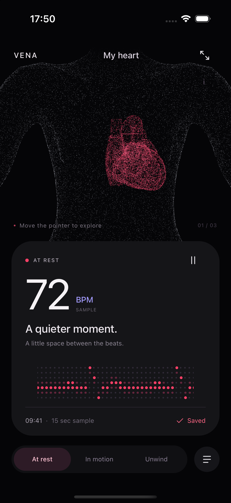

# Vena

A heart made of light. Move the pointer across the anatomy, follow the pulse, or bring the heart into focus.

Vena is an iOS experiment built with NativeScript-Vue 3 and Jolt `0.1.0-rc.11`. Everything runs on the device. The three rhythms are samples; saved selections stay in local storage.



## Run

Use Node 22, the NativeScript CLI, Xcode and CocoaPods on macOS.

```sh
nvm use
npm ci
npm run ios
```

To pick a simulator, pass its identifier with `npm run ios -- --device <udid>`. The native runner handles Homebrew CocoaPods' Ruby paths within its own process.

```sh
npm run typecheck
npm test
npm run build:ios
```

## Pointer interaction

The scene uses `UIHoverGestureRecognizer`: moving a pointer is enough; it does not depend on a tap or drag. Test this on an iPad simulator with pointer simulation enabled, or an iPad with a mouse or trackpad. An iPhone simulator's ordinary mouse input is emulated touch and does not produce the same hover events. See [Apple's hover recognizer documentation](https://developer.apple.com/documentation/uikit/uihovergesturerecognizer).

For mouse hover in the **iPhone simulator**, run this in a second terminal after opening the app:

```sh
npm run pointer -- <simulator-udid>
```

Select that simulator in Device Hub or Simulator, then move the mouse over the body. The helper maps the Mac cursor to the scene using its actual layout, including zoom and window resizing. It uses a small file in the simulator app's cache directory; no server is involved. macOS Accessibility access is required for the terminal. Stop it with Ctrl-C. This input path is restricted to development simulator builds; physical iPads use native hover.

Android scaffolding is present from the initial setup; the current anatomy and visual work target iOS.

## How it moves

- SceneKit renders 72,500 anatomy points. Jolt's native shader properties drive formation, focus, rotation, pointer displacement and light.
- A repeating Jolt motion value drives the heartbeat. There is no JavaScript animation loop moving individual particles.
- Jolt shapes draw the icons and LED signal. Timelines bring in the interface, while springs handle focus and control feedback.
- Motion scopes own the animations. Backgrounding stops scene rendering, and Reduce Motion disables continuous movement. Pausing the rhythm still allows pointer and focus transitions.

`src/components` contains the interface, `src/domain` the sample data, `src/composables` local state, and `src/scene` native rendering. The anatomy exporters live in `scripts`; their binary outputs are bundled with the app.

## Artwork and anatomy

The icon source is [resources/vena-icon.png](resources/vena-icon.png), created with the built-in image generation tool. Its generation prompt is kept in [resources/icon-prompt.txt](resources/icon-prompt.txt). Run `npm run icons` to rebuild the platform icons and launch artwork from it; this export step requires ImageMagick.

Heart anatomy: **BodyParts3D, © The Database Center for Life Science**, licensed under [CC BY 4.0](https://creativecommons.org/licenses/by/4.0/), adapted from OrganUI's prepared model. Torso: MakeHuman `hm08`, CC0. Sources, export steps and modification notices are in [resources/anatomy](resources/anatomy/README.md).

Vena does not measure heart rate or provide medical readings.
